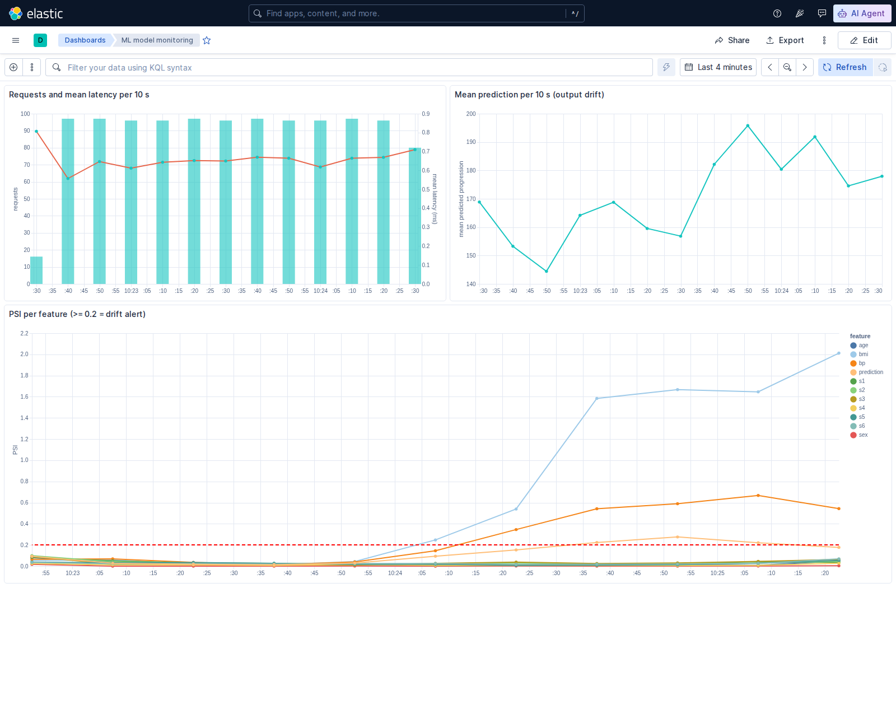

# ELK Lab: Monitoring a Deployed Model for Data Drift with Elasticsearch, Logstash and Kibana

Modified version of the MLOps course ELK lab (`Labs/ELK_Labs/ELK_Docker`). In the original, two scripts retrain an Iris logistic regression every 2 minutes and "detect drift" by injecting random changes and then logging that they injected them. Logstash reads those plain-text logs with a JSON codec, and Elasticsearch 7.16 + Kibana show the result.

This version monitors a **deployed model the way it is done in production**:

1. A **model API** serves predictions and writes one **structured JSON log line per request** (inputs, prediction, latency).
2. **Logstash** ships those lines into **Elasticsearch**.
3. A **drift monitor** reads the last minute of traffic back out of Elasticsearch and **measures** drift against the training data with the **Population Stability Index (PSI)**. It logs its findings the same way.
4. A provisioned **Kibana dashboard** shows traffic, latency, output drift and per-feature PSI with the alert threshold.

A traffic generator sends one minute of normal requests, then one minute of drifted requests. You can watch the monitor catch the drift, and **only** in the features that really changed.



## What changed from the original lab

| Area | Original ELK_Docker lab | This lab |
|---|---|---|
| What is monitored | a training loop that retrains every 2 minutes | a **deployed model API** (FastAPI) receiving live requests, like production |
| Log format | plain text `asctime - level - message` | **one JSON object per line**: request id, model version, all 10 inputs, prediction, latency. No regex parsing needed |
| Logstash pipeline | `codec => json` on plain-text lines (every line fails to parse), then `grok` regexes | `codec => json` on real JSON, a `date` filter so `@timestamp` is the **request time**, tags `slow_request` / `drift_alert`, routing by `event_type` to `ml-predictions` / `ml-drift`, and an `ml-unparsed` index so bad lines are kept instead of lost |
| Drift detection | **simulated**: the script modifies random samples and logs "drift detected" for exactly the ones it modified | **measured**: PSI of each feature and of the predictions over a sliding 60 s window vs. the training reference (decile bins saved at training time), alert at PSI ≥ 0.2 |
| Drift scenario | random scaling/appending of values | realistic: a new population with higher `bmi` (+1 std) and a miscalibrated blood-pressure cuff (`bp` spread ×1.8), on a fixed schedule |
| Kibana | empty, you build everything by hand | index template, two data views and an **"ML model monitoring" dashboard** with 3 panels imported automatically by a `setup` service |
| Elastic version | 7.16.2 (2021) | 9.5.5, all three images pinned |
| Startup order | `depends_on` with no health checks (Logstash often starts before Elasticsearch is ready) | health checks on every service, and `depends_on` conditions: ES healthy → Kibana healthy → setup done → Logstash healthy → traffic and monitor |
| Exposure | ES, Logstash and Kibana published on all interfaces with security off | security still off (local lab), but **every port bound to `127.0.0.1`** |
| Run time | fixed 10–20 minute `sleep` loops | about 3 minutes from `up` to a verified result |
| Testing | none | `verify` service checks the whole chain end to end (6 checks) |
| Metricbeat | included, monitors the stack containers | removed: the lab's focus is monitoring the **model**, not the stack |
| Dataset / model | Iris, logistic regression with random hyperparameters | scikit-learn **diabetes** dataset (442 patients, 10 features), `GradientBoostingRegressor` predicting disease progression |

### Architecture

```
                 ┌────────────┐  POST /predict   ┌─────────────┐
                 │  traffic   │ ───────────────▶ │  model-api  │  FastAPI + GradientBoostingRegressor
                 │ normal 60s │                  │   :8000     │
                 │ drift  60s │                  └──────┬──────┘
                 └────────────┘                         │ predictions.jsonl
                                                        ▼
  ┌───────────────┐  drift.jsonl          ┌──────────────────────┐
  │ drift-monitor │ ────────────────────▶ │  logs volume /logs   │
  │ every 15 s:   │                       └──────────┬───────────┘
  │ PSI over last │                                  │ tail, json codec
  │ 60 s vs train │                       ┌──────────▼───────────┐
  └───────▲───────┘                       │      logstash        │
          │ _search last 60 s             └──────────┬───────────┘
          │                                          │ ml-predictions / ml-drift
  ┌───────┴──────────────────────────────────────────▼───────────┐
  │                 elasticsearch :9200                           │
  └───────────────────────────────┬───────────────────────────────┘
                                  │
                         ┌────────▼────────┐   setup: index template,
                         │  kibana :5601   │   data views, dashboard
                         └─────────────────┘
```

### How the drift check works

At image build time, `app/train.py` trains the model and saves, for every feature and for the model's output, the **decile bin edges** of the training data and the share of training rows in each bin (`model/reference.json`).

Every 15 seconds, `app/drift_monitor.py` fetches the predictions logged in the **last 60 seconds** from Elasticsearch. It needs at least 100 of them. It bins each feature with the training edges and computes

&nbsp;&nbsp;&nbsp;&nbsp;PSI = Σ<sub>bins</sub> (live% − train%) · ln(live% / train%)

The usual reading is: below 0.1 stable, 0.1–0.2 moderate, **0.2 or more significant** (alert). The result is written as a `drift` event with the PSI of every feature, the PSI of the predictions, and the list of features over the threshold.

Two details matter for correctness:

- `sex` is binary and `s4` takes few distinct values, so the bins use unique edges, and the traffic generator resamples **real rows** instead of adding noise. Noise on those features would itself look like drift. An earlier version did that and gave `s4` a PSI of 0.6 on normal traffic.
- The model is fit on a numpy array, because the API predicts from plain lists. Fitting on a DataFrame makes scikit-learn print a feature-name warning on **every** request.

## Requirements

- **Docker Engine 25 or newer** with the **Compose v2 plugin**, or **Docker Desktop 4.27+** on Windows/macOS. The app's `HEALTHCHECK --start-interval` needs Engine 25+. Tested with Docker Engine 29.9.3 and Compose 5.7.1 on Arch Linux x86_64.
- **About 5 GB of free RAM** for Docker. Measured with `docker stats` during a run: Kibana 1.8 GB, Elasticsearch 1.6 GB (512 MB heap), Logstash 0.7 GB, and about 250 MB for the Python services. In Docker Desktop, set **Settings → Resources → Memory** to at least 6 GB.
- **About 4 GB of disk** for the images, and an internet connection for the first pull.
- Free ports **5601** (Kibana), **8000** (model API) and **9200** (Elasticsearch) on `127.0.0.1`.
- A web browser for Kibana. `curl` is optional, for the manual checks.

Nothing else: Python and all packages are installed inside the images.

| Image / package | Version |
|---|---|
| `elasticsearch`, `kibana`, `logstash` | 9.5.5 |
| `python` (app base image) | 3.12-slim |
| fastapi / pydantic / uvicorn | 0.163.1 / 2.14.3 / 0.54.0 |
| scikit-learn / numpy / pandas / joblib | 1.9.1 / 2.5.4 / 3.1.1 / 1.6.0 |

## Setup

### 1. Install Docker

- **Windows / macOS:** install [Docker Desktop](https://docs.docker.com/desktop/), start it, and wait until it says the engine is running.
- **Ubuntu / Debian / Fedora:** `curl -fsSL https://get.docker.com | sudo sh`, then `sudo usermod -aG docker $USER` and log out and back in.
- **Arch:** `sudo pacman -S docker docker-compose docker-buildx`, `sudo systemctl start docker`, `sudo usermod -aG docker $USER` and log out and back in.

Check it:

```bash
docker version --format '{{.Server.Version}}'   # 25.0.0 or newer
docker compose version                          # v2.x or newer
```

### 2. Get the code

```bash
git clone https://github.com/ScradOWO/MLOPs_Labs.git
cd MLOPs_Labs/ELK_Monitoring_Lab
```

Run every command below from this folder.

## Running the lab

### 1. Start everything

```bash
docker compose up -d --build
```

The first run pulls about 3 GB of images and builds the app image, which trains the model (`test MAE 44.5, R2 0.455` in the build log). After that, startup takes about 1 minute, mostly Kibana (52 s on the test machine). Compose starts the services in dependency order and returns once `traffic` and `drift-monitor` have started:

```
 Container elk_monitoring_lab-elasticsearch-1 Healthy
 Container elk_monitoring_lab-kibana-1 Healthy
 Container elk_monitoring_lab-setup-1 Exited
 Container elk_monitoring_lab-logstash-1 Healthy
 Container elk_monitoring_lab-traffic-1 Started
 Container elk_monitoring_lab-drift-monitor-1 Started
```

`docker compose logs setup` should end with `"success":true` and `SETUP DONE`.

### 2. Verify the whole chain

```bash
docker compose run --rm verify
```

This polls Elasticsearch and Kibana for up to 5 minutes, until the traffic run has played out. It takes about 2 minutes on the first run. **Success** looks like this:

```
waiting: 4/6 checks pass
...
PASS  Kibana dashboard 'ML model monitoring' imported
PASS  predictions indexed (>= 1000)
PASS  no unparsed log lines
PASS  a stable window was measured (no alert)
PASS  drift alert raised for bmi and bp
PASS  no false alarm on the untouched features
predictions: 1044, drift checks: 7, alerts: 2
VERIFY PASSED
```

The exact counts vary a little with timing.

### 3. Watch the drift monitor

```bash
docker compose logs drift-monitor --no-log-prefix
```

```
0 predictions in the last 60s (< 100), skipping
n=133 max_psi=0.0997 prediction_psi=0.0921 ok
n=269 max_psi=0.0682 prediction_psi=0.0283 ok
n=415 max_psi=0.0362 prediction_psi=0.0176 ok
n=560 max_psi=0.027 prediction_psi=0.0136 ok
n=568 max_psi=0.0438 prediction_psi=0.0295 ok
n=568 max_psi=0.2477 prediction_psi=0.0943 ALERT drift in ['bmi']
n=569 max_psi=0.5398 prediction_psi=0.153 ALERT drift in ['bmi', 'bp']
n=569 max_psi=1.5845 prediction_psi=0.2236 ALERT drift in ['bmi', 'bp']
n=440 max_psi=1.6676 prediction_psi=0.2757 ALERT drift in ['bmi', 'bp']
...
```

During the normal minute, every PSI stays below 0.1. Once drifted requests fill the window, `bmi` crosses 0.2 first (it shifted more), then `bp`. The other 8 features never alert, and the prediction PSI rises too, because the model's outputs move with `bmi`. After the traffic ends, the window empties and the monitor goes back to `skipping`.

### 4. Open the dashboard

Open **<http://localhost:5601/app/dashboards#/view/ml-monitoring>**. It shows the last 15 minutes and refreshes every 10 s.

- **Requests and mean latency per 10 s:** about 95 requests per bucket, latency under 1 ms.
- **Mean prediction per 10 s:** moves from about 150–165 up to about 180–195 when the drifted population arrives (output drift).
- **PSI per feature:** flat below the red dashed 0.2 line, until `bmi` and then `bp` climb over it.

To browse the raw documents, use **Discover** with the data views **ML predictions** and **ML drift checks**. Useful KQL queries: `alert : true`, `tags : drift_alert`, `prediction > 200`.

### 5. Call the API yourself

```bash
curl -s http://localhost:8000/health
# {"status":"ok","model_version":"gbr-v1"}

curl -s -X POST http://localhost:8000/predict -H 'Content-Type: application/json' \
  -d '{"age":0.04,"sex":0.05,"bmi":0.06,"bp":0.02,"s1":-0.04,"s2":-0.03,"s3":-0.04,"s4":0.0,"s5":0.02,"s6":-0.02}'
# {"request_id":"...","prediction":...,"model_version":"gbr-v1"}
```

Interactive API docs are at <http://localhost:8000/docs>. A request with a missing or non-numeric feature gets an HTTP **422** with the exact field that failed validation, and it is not logged as a prediction.

### 6. Run your own scenario

The traffic service can be re-run with other phases. Each phase is `normal` or `drift` plus a number of seconds:

```bash
docker compose run --rm -e PHASES=normal:90,drift:90,normal:60 traffic
```

The monitor raises the alert during the drift phase and clears it once normal traffic fills the window again. You can see this on the dashboard as the `bmi`/`bp` lines falling back under 0.2.

## Configuration

Set these as environment variables before `docker compose up`, or with `-e` on `docker compose run`:

| Variable | Default | Meaning |
|---|---|---|
| `PHASES` | `normal:60,drift:60` | traffic schedule |
| `RATE` | `10` | requests per second |
| `DRIFT_INTERVAL` | `15` | seconds between drift checks |
| `DRIFT_WINDOW` | `60` | seconds of traffic each check looks at |
| `PSI_ALERT` | `0.2` | PSI at or above this raises an alert |

## Files

| Path | Purpose |
|---|---|
| `compose.yaml` | The 7 services (+ `verify`), health checks, start order, volumes |
| `app/Dockerfile` | One image for `model-api`, `traffic`, `drift-monitor` and `verify`; trains the model at build time |
| `app/train.py` | Trains the regressor, saves `model.joblib` and the drift reference (`reference.json`) |
| `app/api.py` | FastAPI service with input validation; logs one JSON line per prediction |
| `app/traffic.py` | Normal → drifted request generator |
| `app/drift_monitor.py` | Sliding-window PSI drift check against Elasticsearch, with a built-in self-check |
| `app/verify.py` | End-to-end checks |
| `logstash/pipeline.conf` | JSON parsing, timestamps, tags, routing to indices |
| `kibana/setup.sh` | Index template + Kibana saved-object import (run by the `setup` service) |
| `kibana/index-template.json` | Mappings for all `ml-*` indices (strings as keywords, numbers as floats) |
| `kibana/build_dashboard.py` | Generates `kibana/dashboard.ndjson` (data views, 3 Vega-Lite panels, dashboard) |
| `docs/dashboard.png` | Screenshot of the dashboard after a run |

## Cleaning up

```bash
docker compose down -v      # stop everything and delete the Elasticsearch data and log volumes
docker image rm elk-lab-app elasticsearch:9.5.5 kibana:9.5.5 logstash:9.5.5   # optional: free ~3 GB
```

## Troubleshooting

- **Elasticsearch exits with `max virtual memory areas vm.max_map_count [65530] is too low`** (some Linux setups): run `sudo sysctl -w vm.max_map_count=262144`, then `docker compose up -d` again.
- **Elasticsearch or Kibana keep restarting, or `Exited (137)`:** out of memory. Give Docker at least 6 GB (Docker Desktop: Settings → Resources), or close other memory-heavy apps.
- **`docker compose up` waits a long time at "kibana Waiting":** Kibana's first start takes 1–2 minutes on a laptop. Follow it with `docker compose logs -f kibana`.
- **`port is already allocated`:** something else uses 5601, 8000 or 9200. Stop it, or change the left-hand port numbers in `compose.yaml`.
- **The dashboard is empty:** check the time picker shows a range that includes the traffic run (the default is the last 15 minutes). Re-run the traffic with `docker compose run --rm traffic`.
- **`verify` fails "drift alert raised":** the drift checks need 100+ predictions per 60 s window, so `RATE` must be at least 2 requests per second.
